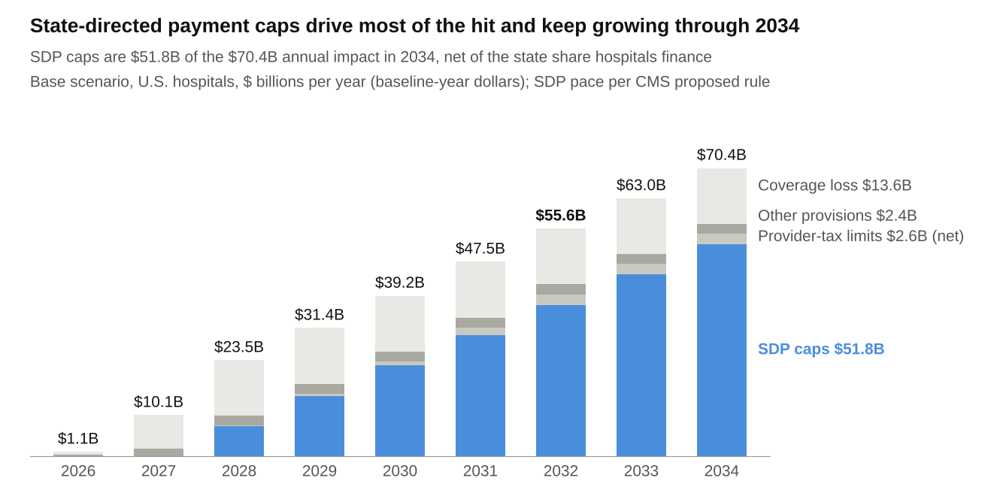
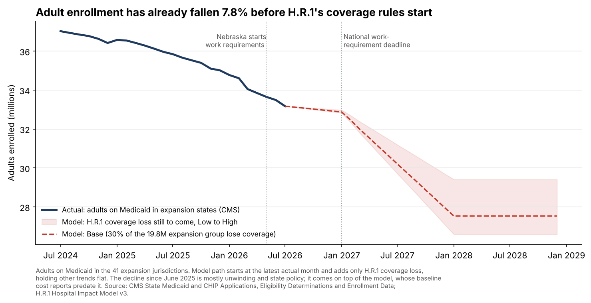

# H.R.1 Hospital Impact Model

A hospital-by-hospital scenario model of how the Medicaid provisions of H.R.1 (the One Big Beautiful Bill Act, P.L. 119-21) could affect U.S. hospital finances from 2026 to 2034.

**Author:** Hamza Saleh, MPH · **Version:** 3 (November 2, 2026) · © 2026 Hamza Saleh, MPH. Text and findings licensed [CC BY 4.0](LICENSE); model and code all rights reserved ([COPYRIGHT.md](COPYRIGHT.md)).

- **Executive brief:** [read online](https://claude.ai/artifact/EYNB1wPBo6jPPWH96G96Le) · [PDF](brief/HR1_Hospital_Impact_Executive_Brief_v3.pdf)
- **Interactive dashboard:** [H.R.1 Hospital Impact Monitor](https://claude.ai/artifact/L4p8BVUD2Sk9D6yDSrjEZM)
- **Full model and Power BI kit:** held in a private repository and available on request (see [Access](#access)).

## New in November 2026

- **[One-page leave-behind](deliverables/HR1_Leave_Behind.pdf)** summarizing the findings.
- **Mitigation scenarios.** A hospital-controllable package (2% cost cut, keeping a quarter of at-risk Medicaid patients covered, +0.5% net collections) closes about 71% of the 2032 gap and keeps about 280 hospitals out of the red. Even with a partial state replacement of capped SDP dollars, about 230 hospitals stay in the red: the top Medicaid-share quarter would need an 8.5% cost cut to absorb the hit.
- **Does the risk score work?** A 2022 version of the vulnerability index, back-tested on what happened next: hospitals in its top fifth were 5 times as likely to convert or stop filing as the bottom fifth, and 15 of 18 later Rural Emergency Hospital conversions came from its top two fifths. Margin and liquidity carry the signal; Medicaid share alone did not predict past exits, because supplemental payments, the money H.R.1 cuts, were keeping those hospitals afloat.
- **Actuals tracker.** Adult Medicaid enrollment in expansion states is already down 7.8% since June 2025, before work requirements start nationally. The tracker compares each new month of CMS data with the model's path.

System-level snapshots (Ochsner, Baptist Health Kentucky, Banner Arizona, Providence Oregon), the analysis code and a presentation deck are in the private repository and available on request.

## Key findings (Base scenario, 2032)

| Measure | Result |
| --- | --- |
| Annual impact on hospital margins | About $56B a year (range $32–91B), 3.5% of revenue |
| Aggregate total margin | 8.0% → 4.7% (6.7% → 3.2% excluding investment income) |
| Hospitals pushed from profit to loss | About 570 (range 330–890) |
| Cumulative impact, 2026–2034 | About $340B (range $200–535B) |
| Adults losing Medicaid coverage at full effect | 5.9 million (in line with CBO) |

- **State-directed payment (SDP) caps, not coverage loss, are the largest exposure.** They are about two-thirds of the 2032 impact and keep growing until programs reach the new limits, around 2035.
- **Exposure is concentrated.** Hospitals in the top quarter by Medicaid share lose about 8% of revenue; the bottom quarter loses 0.4%. Louisiana, Kentucky, New Mexico, Oregon and Arizona face 7–11% revenue hits.
- **The provider-tax limit is small in aggregate but redistributive.** Hospitals lose the payments the tax funded but also stop paying the tax, so the effect moves money from high-Medicaid to low-Medicaid hospitals.
- **The planning window is 2027.** Work requirements start nationally in January 2027 and the SDP phase-down in January 2028.

These are scenario estimates, not forecasts. Every hospital's real exposure depends on its own state's programs.

## What the full model includes

| Component | What it does |
| --- | --- |
| Excel scenario model | Live Low/Base/High and projection-year selectors; national, state and hospital drill-downs for 4,556 hospitals; documented assumptions and calibration checks |
| Power BI build kit | Power Query, DAX measures, build guide and a CSV data pack for the same model |
| Reference implementation | Python version of the model's formulas, used to verify the workbook |
| Documentation | [Methodology summary](docs/METHODOLOGY.md) and a data dictionary |

## How the model works

Four channels, each on its own statutory or regulatory schedule:

1. **State-directed payment caps:** KFF's estimates of federal hospital SDP spending above the new limits, allocated by each state's actual SDP spending, netted for the state share hospitals finance, and phased down per CMS's May 2026 proposed rule.
2. **Coverage loss:** expansion-group enrollment × coverage-loss rate × Medicaid spending per adult × hospital share × net-loss factor.
3. **Provider-tax limits:** each hospital loses its share of the payments its state's above-threshold hospital tax funded and stops paying its own tax; tax dollars that fund SDPs are removed to avoid double counting.
4. **Other eligibility provisions:** retroactive-coverage limits, immigrant-eligibility limits, expansion-adult cost sharing and MCO-tax uniformity, each calibrated to CBO's federal savings.

The baseline is each hospital's latest CMS cost report (fiscal years ending October 2023 to October 2025), including supplemental Medicaid payments from Worksheet S-10 line 5. Results are calibrated against CBO, CMS regulatory impact analyses and KFF.

## Main sources

CMS Hospital Provider Cost Reports and HCRIS raw files; CMS Medicaid and CHIP enrollment data; KFF (state-directed payments, provider taxes, FMAP, Rural Health Transformation awards); CBO coverage and budget estimates; CMS SDP and provider-tax proposed rules (2026); MACPAC MACStats Exhibits 16, 19 and 23; RAND RR-A4098-1; HRSA FORHP rural ZIP file.

## Access

The Excel model, Power BI kit and reference code are kept in a private repository. To request access or a walkthrough of the model, contact Hamza Saleh on [LinkedIn](https://www.linkedin.com/in/hamza-saleh1).

## Licence

The written findings, executive brief, leave-behind, charts and methodology summary in this repository are licensed under [Creative Commons Attribution 4.0 (CC BY 4.0)](LICENSE): share and adapt them freely with credit to *Saleh, H. (2026). H.R.1 Hospital Impact Model. https://github.com/hamzasaleh10/hr1-hospital-impact-model*. The Excel model, Power BI kit and code are not covered and remain all rights reserved. Source data remain under their publishers' terms.
